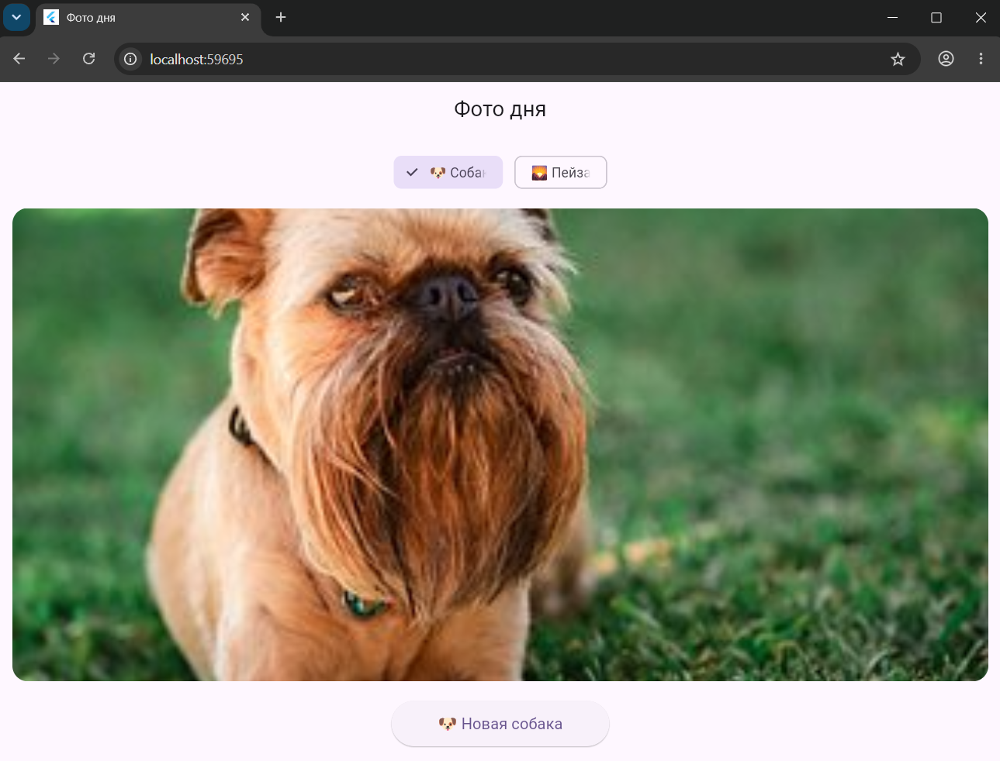

# Приложение «Фото дня»

Flutter-приложение, демонстрирующее применение асинхронного программирования на практике. Приложение имитирует загрузку случайных картинок, корректно отображая индикатор загрузки и обрабатывая возможные ошибки.

## Информация об авторе
**Имя:** Керимов Сейхан
**Группа:** ИСП-243

## Стек и версии
**Framework:** Flutter 3.0+
**Language:** Dart
**Platform:** Web (Google Chrome)
**Packages:** http

## Скриншот приложения

## Запуск
1. git clone <https://github.com/seyhkeri/Flutter_photo_of_the_day>
2. cd photo_of_the_day
3. flutter pub get
4. flutter run -d chrome

## Что изучили
Асинхронность в Dart: изучены базовые концепции Future, async и await для выполнения фоновых задач без зависания интерфейса.
Управление состояниями: реализована обработка трех состояний экрана (загрузка, ошибка, успешное отображение контента).
Работа с ресурсами: освоены методы интеграции и отображения локальных графических ассетов через Image.asset.
Декомпозиция UI: применена практика разделения сложного дерева виджетов метода build() на независимые функциональные методы.

## Ответы на вопросы

### 1. Что такое Future<T>? Чем отличается от обычного возвращаемого значения?
Future<T> - это объект-обещание, который представляет результат асинхронной операции, завершающейся в будущем. В отличие от обычного возвращаемого значения, которое функция отдает мгновенно, Future позволяет программе продолжать работу, пока данные подготавливаются в фоновом режиме.

### 2. Что делает await? Блокирует ли он весь поток выполнения?
Ключевое слово await заставляет программу дождаться завершения выполнения объекта Future и получить его реальное значение. Оно приостанавливает выполнение только текущей асинхронной функции, но при этом не блокирует основной поток выполнения приложения.

### 3. Зачем setState() вызывается дважды в _fetchPhoto()?
Первый вызов setState() на старте функции нужен для мгновенной установки флага загрузки (_isLoading = true) и очистки старых данных, чтобы пользователь сразу увидел индикатор CircularProgressIndicator. Второй вызов выполняется в самом конце после получения результата, чтобы скрыть индикатор загрузки (_isLoading = false) и отобразить полученное изображение.

### 4. Почему кнопке передаётся _fetchPhoto без скобок, а не _fetchPhoto()?
Передача названия функции без скобок (_fetchPhoto) передает кнопку **ссылку на эту функцию**, чтобы она вызывалась только в момент нажатия на элемент интерфейса. Если написать функцию со скобками (_fetchPhoto()), она выполнится мгновенно прямо в процессе сборки дерева виджетов, что приведет к бесконечному циклу перерисовки экрана.

### 5. Чем Image.network() отличается от Image.asset()?
Image.network() скачивает и отображает изображения по прямым ссылкам (URL) из интернета в режиме реального времени. Image.asset() используется для мгновенного считывания и отображения локальных файлов, которые заранее встроены в проект и задекларированы внутри конфигурационного файла pubspec.yaml.
